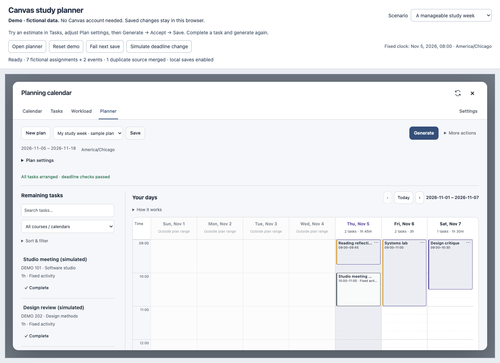

# Canvas Planning Calendar

A Chrome extension that turns Canvas deadlines, estimated effort, and available study time into a concrete schedule. Students can review assignments, set working windows and daily capacity, generate work blocks, see conflicts and missing work, mark tasks complete, and regenerate the remaining plan.

**Try it without a Canvas account.** The local demo uses the same interface, scheduler, validator, and persistence services with clearly labeled fictional data. No backend, API key, or AI service is required.



## Run the demo

Prerequisites: Node.js **22.12+**, npm, and a current Chrome/Chromium browser.

```bash
npm ci
npm run demo
```

Open [the local demo](http://127.0.0.1:4173/). The server binds only to your computer and stops after one hour; Ctrl+C stops it sooner. To choose another port: `node scripts/preview.mjs --port=4175 --timeout=3600`.

1. Open **Tasks**, select **Reading reflection**, change its estimated effort, and save.
2. Open **Planner**. Click **Update plan task data** when an estimate has changed. Expand **Plan settings** to change working hours, capacity, dates, or rest days.
3. Click **Generate**. Review the preview, **Accept generated plan**, then **Save**. Accept changes the draft; Save persists it.
4. Complete a task in Tasks or its plan editor, then generate and save again. Refresh the browser to verify saved estimates, completion, and plans.
5. Select **Too much work, too little time** to see each unassigned task and its missing minutes. **Simulate deadline change** demonstrates stale task data and a newly infeasible deadline. **Fail next save** demonstrates error recovery without discarding the draft.

The demo clock stays at **November 5, 2026, 08:00 America/Chicago** so the walkthrough stays repeatable. Normal and constrained scenarios have separate browser-local storage; **Reset demo** restores only the selected fictional scenario. The standard sample contains seven assignments (one already completed), two fixed events, and a deliberately duplicated assignment source. Refresh does not duplicate tasks. A [two-minute demo script](docs/demo-guide.md) and [Chinese usage guide](docs/usage-zh.md) provide more detail.

## Install the extension

```bash
npm run build
```

Open `chrome://extensions`, enable Developer mode, select **Load unpacked**, and choose `dist/`. Sign into [Illinois Canvas](https://canvas.illinois.edu/calendar), reload the calendar, and select **Planning / 规划** next to the native calendar views. After source changes, rebuild, reload the extension, and refresh Canvas.

The integration is currently scoped to `canvas.illinois.edu`. It reads the signed-in user's calendar through Canvas APIs; local completion, estimates, targets, and work blocks do **not** submit work to Canvas or modify its deadlines. The build also includes `demo.html` as an extension-local demo page.

## What is implemented

- Canvas assignment/event loading with pagination, selected calendars, bounded date ranges, account-scoped caching, and explicit authentication/access errors.
- A searchable task agenda; local completion and undo; manual/rule/default effort estimates; personal finish targets; English and Chinese controls.
- Per-weekday working windows, daily capacities, date overrides/rest days, fixed calendar events, and configurable breaks.
- Automatic planning with a preview, per-task unassigned minutes/reasons, deadline/conflict checks, manual keyboard-accessible arrangement, drag-and-drop, and locked blocks.
- Saved plan revisions, stale-data detection, completion-aware regeneration, and reload persistence. Deadline reminders and themes remain existing optional features; they are outside the core demo.

## Architecture

| Boundary | Main modules | Responsibility |
| --- | --- | --- |
| Extension integration | `content.js`, `background.js`, `canvas-api.js` | Mount the view, read Canvas, coordinate background requests |
| Task domain | `model.js`, `tasks.js`, `estimates.js`, `dates.js` | Stable identities, deduplication, completion/effort, local dates and real instants |
| Planning domain | `plans.js`, `availability.js`, `plan-validation.js`, `scheduler.js` | Plan snapshots, legal intervals, constraint checks, bounded scheduling |
| Persistence | `storage.js`, `plan-service.js` | Account isolation, validated records, serialized task edits, revision-checked plan writes |
| Interface | `view.js`, `tasks-view.js`, `planner-view.js`, `planner-week-view.js` | Native DOM controls inside a Shadow DOM, task/editor/week views |
| Demo adapters | `demo/data.js`, `demo/storage.js`, `demo/demo.js` | Fixed fictional inputs and isolated local storage around the production core |

Source files live under `src/`. The extension has no runtime framework or hosted service; esbuild bundles ES modules for Manifest V3. Playwright and axe are development dependencies. See the [code tour and interview questions](docs/code-tour.md).

## Scheduling method and tradeoffs

The planner enforces releases, true deadlines, manual start days, the plan horizon, fixed events, working windows, daily capacity, completion, and retained locks. Default estimates are 60 minutes. Tasks remain continuous unless the user explicitly permits splitting **and** the estimate exceeds the configured threshold (60 minutes by default). Personal finish targets are displayed separately; they are not scheduling deadlines.

It first tries continuous placement with bounded backtracking and deadline-oriented ordering. If that fails, permitted tasks can be split: zero-break plans use a day/interval/task maximum-flow subproblem; plans with breaks use greedy placement that reserves the actual gaps. A local improvement phase moves whole unlocked blocks to reduce daily peak load, then capacity-weighted imbalance and deadline proximity. Generated results are checked by a separate validation module before acceptance.

**This is a bounded heuristic, not a global optimizer.** Continuous candidates use interval boundaries; each search pass is capped at 2,000 states, and the extension uses a cooperative five-second calculation budget. Search exhaustion and timeouts are disclosed. A partial result does not prove no complete schedule exists. Every missing task remains in `validation.unassigned`, with missing minutes and an explanation in the preview. Invalid facts or conflicting locks must be resolved before a new calculation. See [the algorithm notes](docs/scheduling.md) for precise constraints and limitations.

Times are stored as ISO instants with an offset and interpreted in the Canvas account's IANA zone. Missing DST clock times are rejected; repeated local times use the earlier start and later availability-window end. Work minutes count elapsed time, including 23/25-hour days. The browser tests run with an Asia/Shanghai browser zone against an America/Chicago account.

## Verification

```bash
npm test                         # Node domain, service, and DOM integration tests
npx playwright install chromium  # one-time browser installation
npm run test:e2e                  # builds, then runs real Chromium browser tests
npm run benchmark                # fixed data; correctness checked on every run
npm run screenshots              # creates four fictional screenshots locally
```

Current verification includes **448 Node tests** and **8 browser scenarios** covering the complete demo, insufficient time, save/retry/reload, changed deadlines, keyboard/narrow-screen accessibility, no external demo requests, and an installed Manifest V3 extension with **simulated Canvas API responses**. Exact final counts, commands, environment, and remaining gaps are in the [verification record](docs/verification-2026-11-06.md). The GitHub Actions workflow runs the Node suite, browser scenarios, and benchmark on Linux / Node 22; see [Actions](https://github.com/fuarthur/canvas-extension/actions) for the status of each commit.

The [recorded benchmark](docs/benchmark-2026-11-05.json) uses fixed 28-day fixtures with 20/60/200 tasks, one warmup and three measured runs. Each run checks deadlines, release times, total effort, capacity, and breaks. Timings are local observations, not a performance improvement claim or a guarantee for arbitrary inputs.

## Known limits and verification boundaries

- **Live authenticated Canvas, actual course permissions, system notifications, and sleep/restart behavior were not verified in this task.** Automated extension integration uses fully simulated responses; it does not establish live API compatibility.
- The calendar API only provides dated items from selected calendars and the loaded range. Undated assignments may not be returned at all. Malformed/undated records that are returned get visible import warnings; conflicting duplicate dates block scheduling until refreshed.
- One working window per day; no overnight window, task dependencies, recurring local events, or partial-progress tracking. Completing a task marks the whole task complete. Completed and locked blocks are retained during regeneration.
- Regeneration replaces unfinished unlocked work. Deleted or unloaded tasks remain unverifiable in saved plans and block automatic generation until reviewed; estimates/date changes require explicit task-data updates.
- Estimates are user/rule inputs. No learned estimates, measured learning benefit, global-optimality claim, user-count claim, or large-scale production claim is made.
- Planning stores data on this device, with no cloud sync. The demo uses origin-local storage and Web Locks for cross-tab mutation serialization; runtimes without Web Locks only serialize within the current page.
- Automated accessibility checks cover sampled Calendar/Planner states and keyboard tab navigation, not a full screen-reader or physical-device certification. The week grid can scroll horizontally on narrow screens; **Arrange** provides a keyboard alternative.

[Project walkthrough](docs/demo-guide.md) · [Code tour / interview prep / resume drafts](docs/code-tour.md) · [Detailed Chinese guide](docs/usage-zh.md) · [Work log](docs/portfolio-progress.md)
