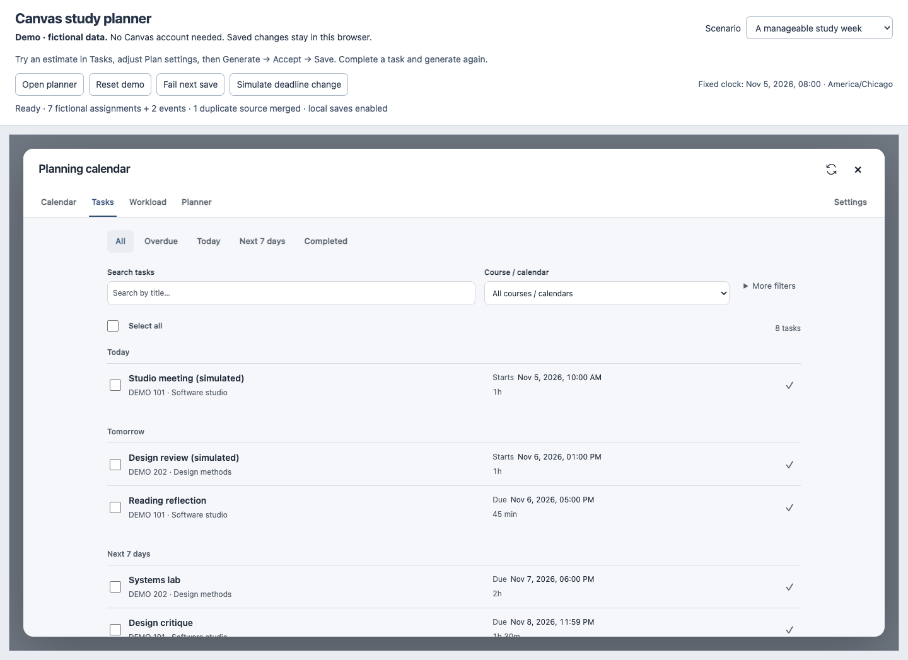
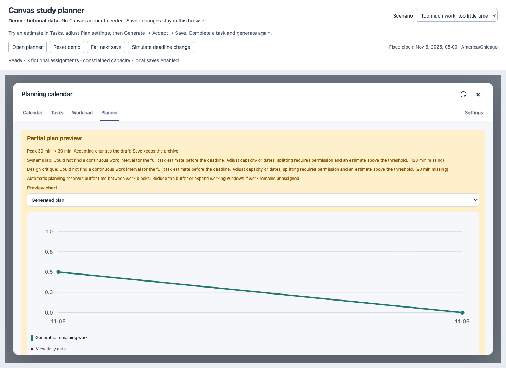

# A two-minute project demonstration

All screenshots and examples below use fictional data. The clock is fixed at November 5, 2026, 08:00 in America/Chicago. Nothing is sent to Canvas.

## Start

Run `npm ci`, then `npm run demo`, and open `http://127.0.0.1:4173/`. Click **Reset demo** to start from the original sample if you have used it before. Keep the **A manageable study week** scenario selected.

## Suggested narration and actions

1. **“Deadlines tell me when work is due, but not when to do it.”** Open Tasks. Show the two courses, fixed events, estimates, and completion controls. The duplicate source is merged, so the list has eight pending rows: six assignments and two events. Completed sample is available through the Completed filter.
2. **“Effort and availability are explicit inputs.”** Open Reading reflection, set effort to 75 minutes and save. Close details, select Planner, and click Update plan task data. Expand Plan settings and change Thursday's capacity to 150 minutes. Close the disclosure for a clearer view.
3. **“A candidate is checked before I keep it.”** Generate, inspect the preview, Accept generated plan, then Save. The view reports all tasks arranged. Point out the account time zone and the studio meeting that blocks time. Refresh and reopen Planner to show persistence.
4. **“Plans change as tasks change.”** In Tasks, complete Reading reflection. Return to Planner and Generate → Accept → Save. Completed work is retained but does not consume remaining workload.
5. **“The planner does not hide work that cannot fit.”** Select Too much work, too little time. Generate. Reading reflection fits; Systems lab is missing 120 minutes and Design critique is missing 90 minutes. The partial preview lists both tasks and reasons. Accepting/saving this candidate retains the missing-work status.
6. **Optional recovery example.** In the normal scenario, change the plan name, click Fail next save, then Save. The draft and old saved data survive; retry succeeds. Simulate deadline change makes Systems lab due at noon on the fixed date, with no continuous two-hour opening before the deadline; Update plan task data and regenerate to see the explicit partial result.

The toolbar scenario controls belong only to the demo. The task, settings, plan, validation, completion, save, and scheduling flows reuse production code. The installed extension uses authenticated Canvas APIs, Chrome storage and background messaging in place of these data adapters.

## Public-safe presentation material

The [narrow-screen task view](demo/tasks-narrow.png) is also available. Regenerate all four images with `npm run screenshots` after installing Playwright Chromium. The capture tool starts its own loopback server on port 4174 and stops it afterwards.

For a recording, use these same synthetic scenarios and keep the fictional-data banner visible. No recording or external hosting has been created in this task.

## If something goes wrong

- A blocked local-storage setting or quota error is reported; enable local storage/free space and retry. Corrupt demo bytes are not silently overwritten; Reset demo restores only the current sample.
- Use the same host and port to restore the same demo storage. `localhost` and `127.0.0.1`, different ports, browser profiles, and normal/private windows have separate origins/storage.
- Node's `EPERM` when listening means the environment denied a local server. Run it in a terminal allowed to bind loopback. A port-in-use error can be resolved with `--port=4175`.
- Reloading preserves saved changes; an unsaved plan draft is intentionally only in memory. Save before reloading. Reset is intentionally destructive only to the selected fictional scenario.
