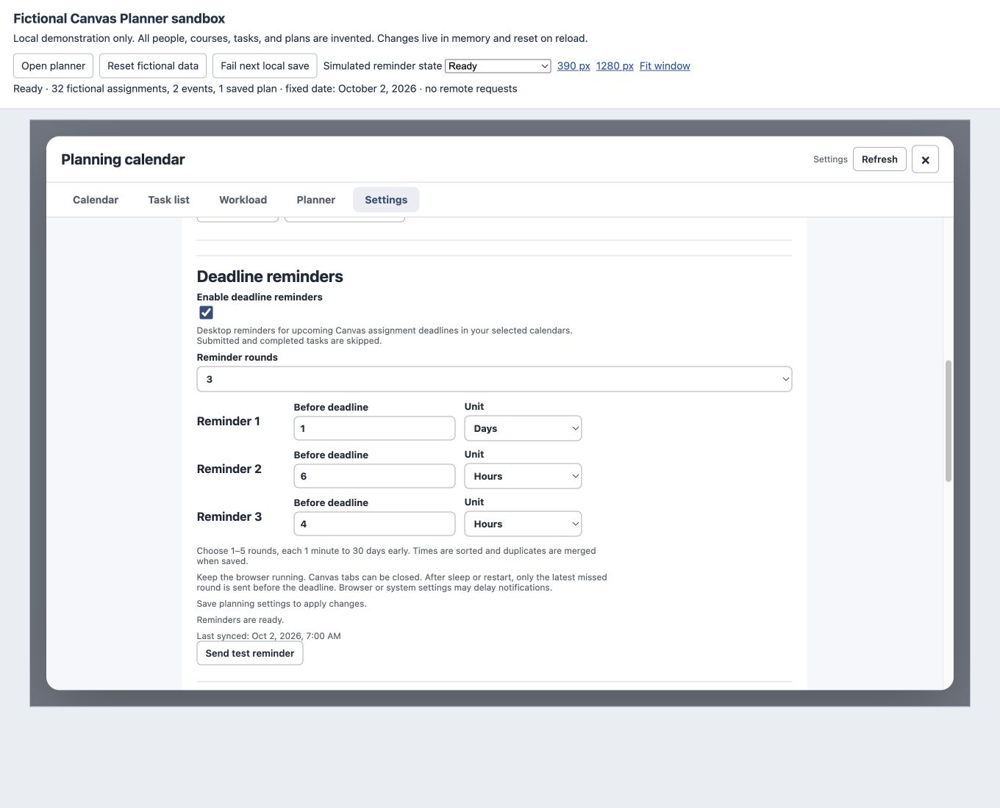
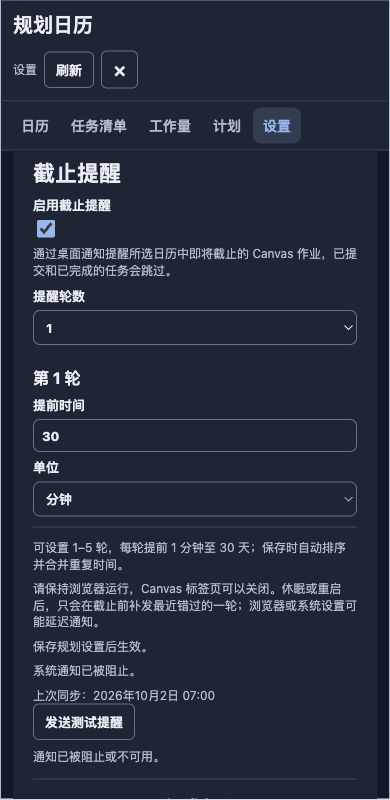

# Canvas 截止提醒验收记录

日期：2026-10-04。分支：`codex/deadline-reminders`。本次为本地功能实现，版本保持 0.3.6，未发布新版本。

## 实现结果

Settings 增加截止提醒，默认关闭，预设 1 轮、提前 2 小时。每轮独立配置分钟、小时或天，支持 1–5 轮、提前 1 分钟至 30 天；保存时按整数分钟排序去重并回填实际轮数。同步状态、上次同步时间和合成测试按钮可用；保存失败保留草稿。

后台按当前验证账号和所选日历读取真实 Canvas 作业 DDL，跳过已提交、本地已完成、无 DDL 和逾期作业。15 分钟刷新与最近轮次 alarm 配合，持久记录发送身份；恢复时只补发尚未截止作业最近错过的一轮。离线快照有效期小于 24 小时，AUTH 立即丢弃可发送数据，重新验证成功后恢复。通知名称保持原文，使用账号时区；点击只打开 Illinois Canvas。

## 自动化与构建

- 基线 341 项通过；最终 `npm test`：**396/396 通过，0 失败，退出码 0**。
- `npm run build` 通过，`git diff --check` 通过。
- package、源 manifest、构建 manifest 均为 0.3.6；权限精确为 `storage`、`alarms`、`notifications`，主机仍只有 `https://canvas.illinois.edu/*`。
- 构建产物包含后台代码和本地 128×128 RGBA 通知 PNG，已解压 IDAT 并核对完整像素长度。
- callback-only Chrome 模拟器运行打包后的后台，无 DOM 也可启动、重建丢失 alarm、通知并去重；原计划消息、toolbar 和 scheduler 监听继续存在。
- 覆盖规范化 DDL、夏令时、最新轮次补发、离线过期、AUTH 恢复、账号和配置竞争、占位保存失败、创建失败重试、通知权限、空选择、部分日历不可用、原设置保留、状态只读及内部写入不循环。

这些测试中的 Canvas API、浏览器 alarm、通知和重启均为模拟，不能证明真实系统投递或后台 Cookie 可用。

## 浏览器界面检查

通过本机 `quality-preview.html`，使用全部虚构课程、作业和账号；保存只写内存，提醒客户端为合成响应，不发送系统通知。

- 1280px 预览中的英文浅色：默认关闭、1 轮、2 小时；打开后增加至 3 轮，各轮布局可用。
- 输入 4 小时保存后确实显示 4 小时；0.5 小时保存后显示 30 分钟。
- 增至 5 轮、减至 2 轮；将三轮都设为 2 小时后保存，实际显示 1 轮及合并提示。
- 注入一次保存失败，输入保留，重试成功；offline 状态更新保留正在编辑的 4 小时。
- 英文深色下检查通知被阻止提示；390px 中文浅色编辑、保存后切深色，数值及单位纵向排列，提示正常换行。
- 测试按钮的成功反馈及 denied 错误反馈均已检查；中英文标签、禁用和焦点另有自动化覆盖。

## 独立审查与修复

一名独立 `gpt-6-astra` 审查员只读检查 `45997a4..e5df4e0` 整条分支及规格、计划、Review Focus。无 Critical 或 Minor；两项 Important 均由主实现者复现并修复，没有另做重复审查。

1. 同账号 Refresh 创建新 store 后，原 Settings 保存错误地判成账号切换。改为稳定账号及当前 editor 校验，并在保存时使用当前 store。使用每次返回新 store 的测试先失败后通过。
2. 第一次账号验证未结束时保存配置，会取消注册并漏建 alarm。区分账号身份与配置失效；配置变化重试当前已验证身份，更晚账号仍会取消旧注册。首次启用竞争测试先失败后通过，跨账号取消继续通过。

浏览器检查还发现提前数值仅在 blur/change 后更新草稿，已增加 input 捕获；对应测试先失败后通过，实际界面复核保存 4 小时和 0.5 小时均正确。修复后整套 396 项通过。

## 决策及验证范围

- 沿用现有干净的功能分支和原工作目录，不另建 checkout，避免移动当前扩展路径；若出现并行改动，需要协调共享目录。
- 真实系统投递、后台认证读取及实际 Chrome 重启不属于模拟证据，明确留为未验证；若存在平台差异，必须在真实检查中发现。
- 最终界面与交付文档由主实现者检查，未另作独立审查；截图与说明的细节仍依赖作者检查。
- 无暂缓的 Minor 问题。

## 用户重载后的真实检查（尚未执行）

- [ ] 在 Chrome 扩展管理页手动重载本项目 `dist`，刷新 Canvas 日历页。
- [ ] 保持默认关闭，点击“发送测试提醒”，确认系统实际收到通知，点击后打开 Canvas 日历。
- [ ] 检查浏览器及系统通知权限被拒绝时的真实提示。
- [ ] 自行开启并保存配置，确认当前账号的后台 profile/作业读取和上次同步时间。
- [ ] 关闭 Canvas 标签页后保持浏览器运行，检查实际同步和提醒。
- [ ] 重启或休眠恢复后检查 alarm 重建、最新轮次补发及已发送轮次不重复。

本次没有自动操作 `chrome://extensions`，没有启用用户的真实作业提醒或改变真实日历选择。
