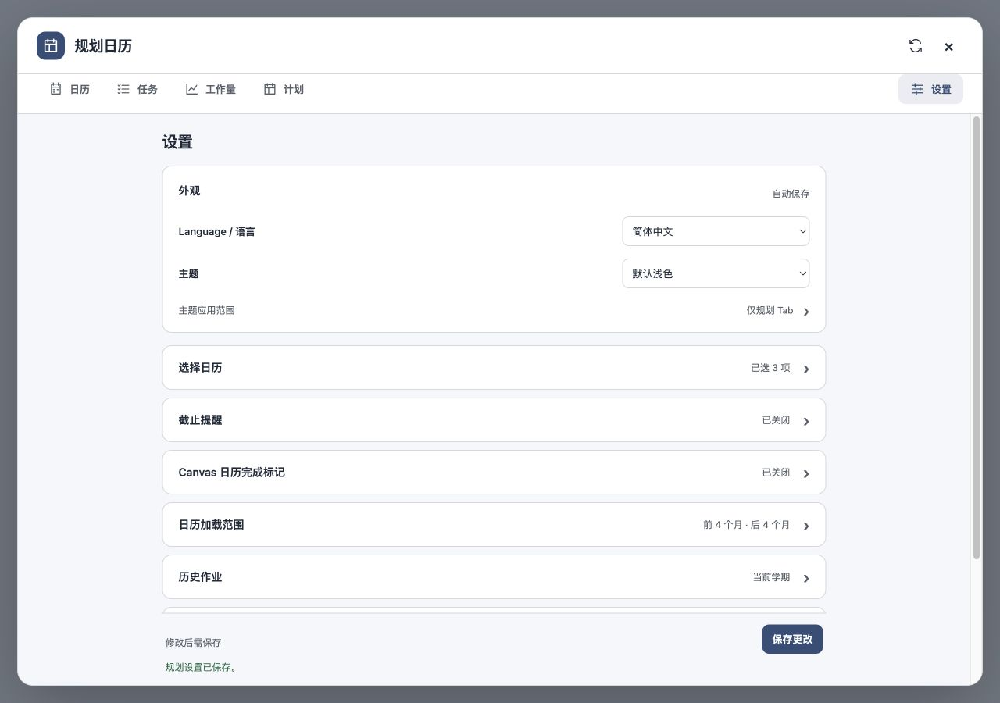
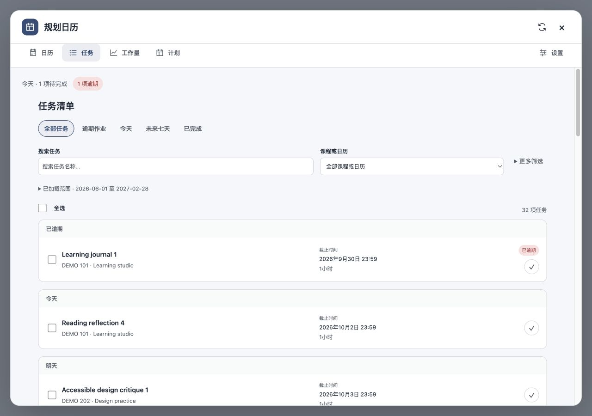
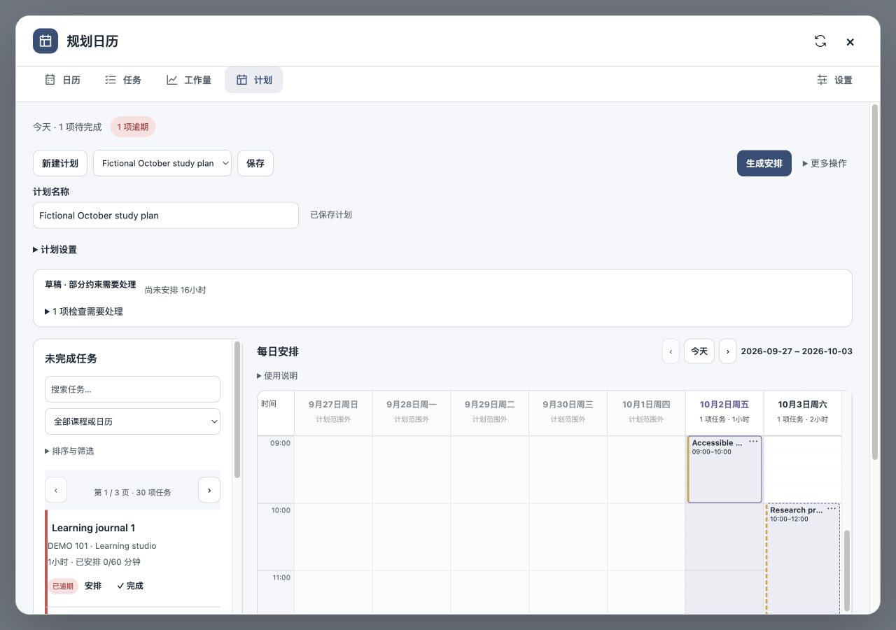
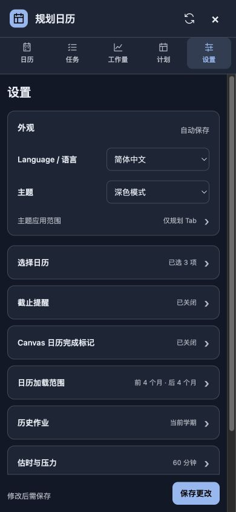

# UI/UX refresh acceptance — 2026-10-12

## Scope and design choices

The request was to research public UI libraries such as Telegram UI, simplify the extension's text-heavy interface, and improve both UI and UX. This change uses Telegram UI's grouped rows, Radix's consistent spacing and keyboard conventions, and shadcn/ui's semantic theme approach. The [research note](../../research/2026-10-12-ui-libraries.md) links the upstream documentation and explains why the extension keeps its native DOM renderer without adding React or another runtime dependency.

- A shared interface layer provides concise icon-and-text navigation, consistent controls, grouped surfaces, and responsive light/dark styling using the existing theme tokens.
- Settings keep appearance visible and show current-value summaries for collapsed groups. Longer explanations live under “How it works.” A sticky save area distinguishes automatic appearance changes from explicit planning-setting saves and updates dirty feedback while typing.
- Validation reveals hidden controls, including invalid values in an inactive loading mode or while reminders are switched off. Draft values and the selected mode/enable state survive recovery.
- Tasks support completion/reopening directly from a row, using the existing persistence and undo boundary. Active advanced filters can be removed individually. Completed filters and their shortcut stay in sync. Successful row actions move keyboard focus to Undo; failed actions restore the triggering control.
- Plan dates/configuration and uncommon pool filters are collapsed. Save, Generate, and Accept preview use the primary visual treatment according to the current state. Workload methodology and drag instructions remain available in disclosures.
- Tabs have a single tab stop, arrow/Home/End navigation and an associated panel. Activation remains explicit with Enter/Space so moving focus does not trigger unsaved-plan decisions. Escape dismisses an open action list before closing the planner.

Calendar data, planning algorithms, persisted schema, Canvas write behavior, host permissions, and notification delivery rules are unchanged.

## Automated verification

- `npm test`: **404 passed, 0 failed, 0 skipped**.
- `npm run build`: passed without warnings; rebuilt the local `dist` extension.
- `git diff --check`: passed.
- New regression coverage exercises keyboard tab navigation, Escape priority, quick completion and undo/failure focus, removable completion filters, live settings summaries, collapsed validation, and recovery after switching loading/reminder states.

## Standards review

Independent standards review found no documented-standard violations. Its keyboard-focus and delayed dirty-feedback findings were fixed and retested. The follow-up review reported no remaining P1/P2 issue or obvious regression.

## Spec review

Independent spec review found removable Completed filters and hidden invalid loading/reminder inputs inconsistent with the requested usable progressive disclosure. These were fixed with regression tests; the follow-up reported no remaining P1/P2 issue in its review scope.

## Browser verification

Used the repository's fictional quality sandbox, not the user's Canvas account. Checked desktop at 1280 × 900 and a narrow viewport at 390 × 844, English/Chinese, and light/dark themes. Reviewed Calendar, Tasks, Workload, Plan and Settings; verified task completion → Undo, loading validation after mode changes, saving a corrected draft, and Escape on the plan action list. The task and settings content area measured 375 px wide with 375 px scroll width in the narrow layout. The calendar and weekly timeline retain intentional local horizontal scrolling.

No warning/error messages were captured in the preview browser during the checked flows. Temporary viewport overrides were reset. Screenshots contain fictional demo data.

### Desktop settings

### Desktop tasks

### Desktop plan

### Narrow dark settings

## Delivery boundary

This is a local source/build change. Reload the unpacked extension from `dist` in Chrome's extension manager, then refresh Canvas to use it. This pass does not claim live Canvas integration, real system notifications, or a published release; those were not exercised by the fictional preview.
