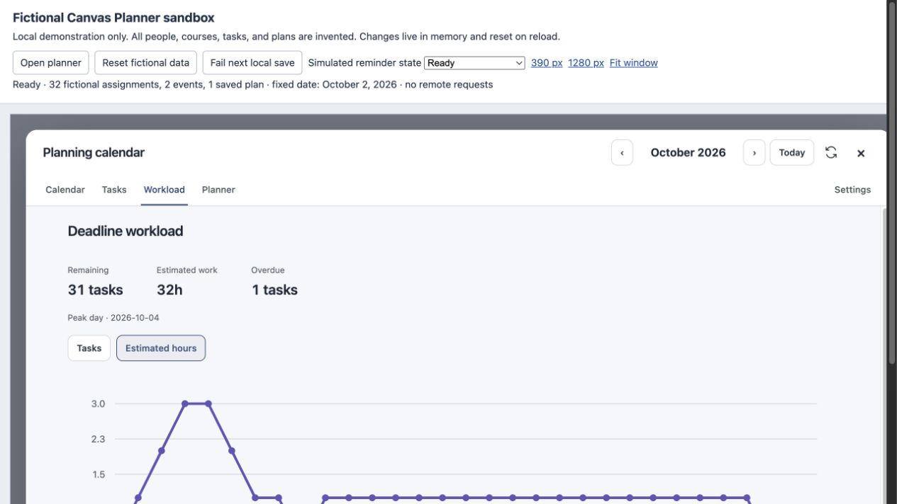
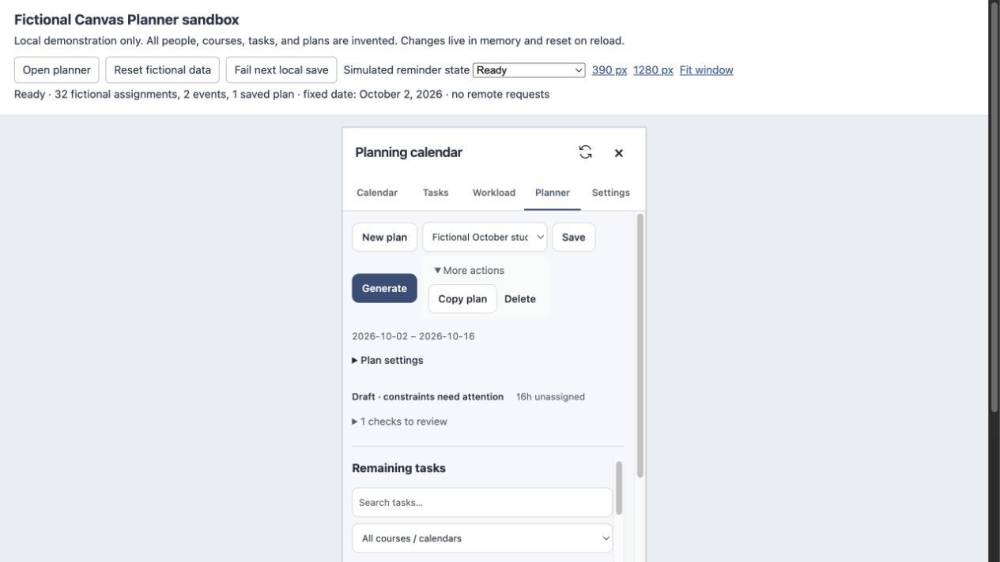
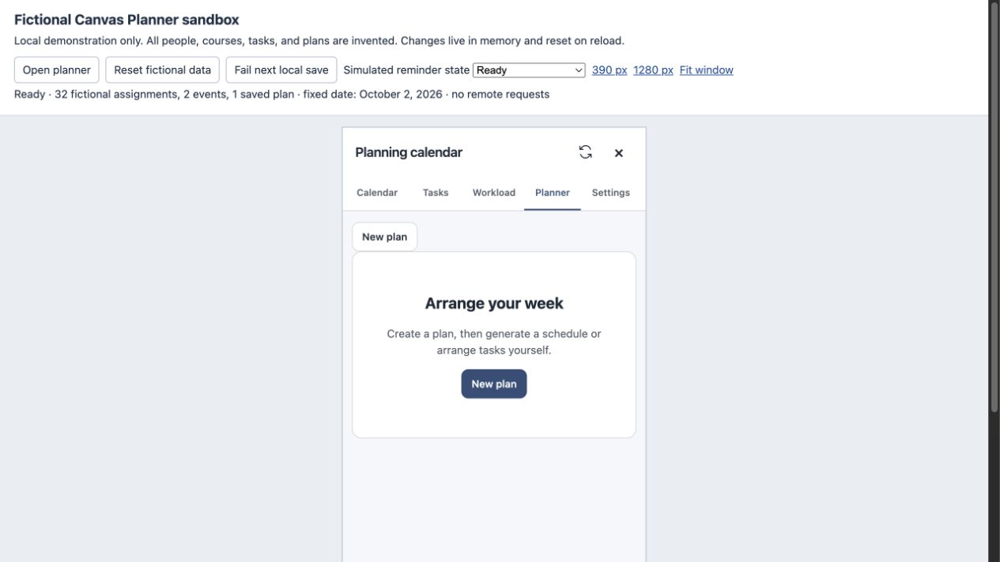

# 全库代码审阅与优化 — 2026-10-27

已完成本轮审阅、修复和复审。检查覆盖全部 50 个 `src` 模块、两个构建/预览脚本、扩展清单、依赖声明及相关测试。确认并修复 6 类问题，新增 12 项回归；本次提交内容独立运行的 416 项测试全部通过。包含先前未提交改动的审阅工作区从 413 项增至 425 项，也全部通过。

## 范围与依据

- 使用 `ask-matt` 路由到代码审阅、问题复现和回归修复流程；Standards 与 Spec 两路独立审阅并复查最终差异。
- 依据 README、`docs/superpowers/specs/`、现有实现和测试契约。未发现仓库或祖先目录的 AGENTS.md，也没有独立的编码规范文件。
- 起点为 `a8887f76fd7e799f661bacb57444d1e2f1668b9b` 及当前工作区。开始时已有 5 个未提交文件，涉及原生月份同步、失效课程筛选和消失活动编辑器；这些修改均保留，其测试计入 413 项基线。
- 初始差异备份在本机 `/tmp/canvas-review-starting-changes.patch`。提交范围仅包含本轮新增修复、测试和审阅记录；原有 5 个文件的改动及其 9 项测试继续保留在本地，不进入这次提交。`dist` 已重新构建。

## Standards

以下为已复现的正确性、异常恢复和性能问题，不是对代码风格的偏好。

| 问题 | 复现与影响 | 修复 |
| --- | --- | --- |
| P2：损坏存档阻断加载 | 计划的 `segments` 包含 `null` 时，校验读取 `s.id` 抛异常。一个坏计划会阻止全部规划数据加载；后台保存入口也会拒绝返回。 | [storage.js](../../../src/storage.js) 拒绝空工作段；保留坏记录并显示警告，其他计划和估时继续加载。后台返回 `INVALID`，不写入。 |
| P2：范围校验先展开全部日期 | 输入结束日期 `9999-12-31` 时，原实现先枚举数百万日期，再检查 180/732 天上限；本机回归约 5.5 秒后仍以错误类型不符的异常结束。日期列表还会在最后一天之后多推进一步。 | [dates.js](../../../src/dates.js) 增加包含两端的常数时间 `dayCount`；[plans.js](../../../src/plans.js)、[canvas-api.js](../../../src/canvas-api.js) 和存档校验统一使用。日期列表到末端立即返回。原有上限不变。 |
| P2：删除回复依赖已变化的草稿 | 后台删除成功、存储通知先到时，当前草稿可能已被清空，回复继续读取 `draft.id` 导致异常。等待期间切换另一计划，旧回复还可能清除新草稿。 | [planner-view.js](../../../src/planner-view.js) 在确认前捕获目标 ID、版本和名称；仅清理目标记录，保留另一计划的新编辑。增加重复确认、保存中、销毁后回复及请求失败处理。 |
| P2：刷新后主题控件显示旧值 | 同账号刷新会创建新的 store，但保留主题编辑器。旧回调以 store 对象相等判断生命周期，迟到回复无法读取其他页面刚保存的主题，导致实际配色与控件值不一致；应用范围也受影响。 | [view.js](../../../src/view.js) 按账号及编辑器生命周期检查，并从当前 store 读取最终值，保留未保存设置。 |

Standards 复审：上述 4 类问题已处理，未发现需要继续修复的问题。

## Spec

| 问题 | 要求与复现 | 修复 |
| --- | --- | --- |
| P2：小时指标沿用任务数峰值 | Workload 设计要求切换任务数/预计小时并显示峰值日。10/1 一项 240 分钟、10/2 两项共 20 分钟时，小时图仍标 10/2 为峰值。 | [workload-view.js](../../../src/workload-view.js) 按当前指标计算并更新峰值日；并列时保留首日，空数据保留空状态。 |
| P2：回拨小时固定活动被缩短 | README 要求固定事件按原始时间显示。Chicago 的 `2026-11-01 01:30 -05:00 → 01:30 -06:00` 实际 60 分钟，原周视图仅绘制 15 分钟高度。 | [planner-week-view.js](../../../src/planner-week-view.js) 在结束钟面时间不大于开始时，以当日裁剪后的真实时长回退计算；保留原事件时间及不可拖动属性。 |

Spec 复审：上述 2 类问题已处理；独立复现也检查了结束钟面更早的回拨区间，以及 180/181、732/733 天边界，未发现新增可行动问题。

## 验证

| 检查 | 结果 |
| --- | --- |
| 修改前 `npm test` | 413 通过，0 失败 |
| 新问题回归 | 先观察旧实现失败，再验证修复；覆盖存档恢复、删除竞态、跨页主题竞争、极端日期、指标切换及 DST 活动 |
| 修改后工作区 `npm test`（包含原有本地改动） | 425 通过，0 失败、跳过或取消 |
| 本次提交内容独立运行 `npm test`（排除原有 9 项测试） | 416 通过，0 失败、跳过或取消；构建通过 |
| `npm run build` | 通过，生成当前 `dist` |
| `git diff --check` | 通过 |
| UI 机械检查 | 对 4 个改动界面模块运行 Impeccable detector，结果为空 |
| 独立最终复审 | Standards、Spec 均通过 |

极端范围样例在最终完整测试中分别约 0.11 ms（API 拒绝）和 0.20 ms（损坏存档恢复）。这些是本机样例测量，不代表整个扩展的运行速度。

浏览器检查使用现有本机虚构数据预览：32 个虚构作业、2 个活动和 1 个计划；没有读取或修改真实 Canvas 数据。检查了 1280px 宽屏和 390px 窄屏：

- 宽屏 Workload 从任务数切到小时后，峰值从 10 月 5 日更新为 10 月 4 日。
- 窄屏计划页操作可见；删除虚构计划后正常进入空状态，没有卡住的确认提示。
- 异步竞态和 DST 精确场景由自动回归验证，浏览器预览用于检查显示和基本交互。

## 后续候选与验证边界

两项可选维护工作：继续收拢控制器的账号/编辑器生命周期判断；清理样式中确定被后续规则覆盖的重复声明。它们尚无本轮必须修复的行为证据，未扩大重构范围。

固定活动本身超过日容量时，当前逻辑将可安排容量截到零。现有文档没有明确规定是否还要阻止完整成功状态，属于后续产品语义选择，本轮保持原行为。

本轮没有重新加载用户正在使用的 Chrome 扩展，也没有复验真实 Canvas 登录、系统桌面通知和浏览器重启。使用本轮构建需要在扩展管理页重新加载扩展，再刷新 Canvas 页面。权限、依赖版本、数据格式和 Canvas 写入范围均未改变。
